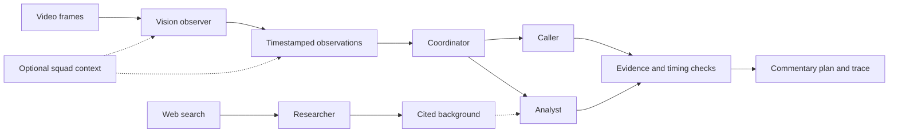

# AI Football Commentary

[**Commentary clips**](https://www.aarshroongta.com/projects/soccer-commentary) ·
[Architecture](#architecture) · [Quick start](#quick-start) · [Evaluation](#evaluation)

AI commentary for short football clips, with a play-by-play caller and an analyst.
A vision agent watches the footage, a researcher finds relevant background, and the
speaking agents decide what to say. Python code handles timing and checks what
each agent is allowed to use.

Built with Python, LangGraph, Pydantic, asyncio, OpenCV and Next.js. Generation
uses existing models; there is no training or fine-tuning.

## Demo

The [commentary page](https://www.aarshroongta.com/projects/soccer-commentary) has
three clips with two voices and captions:

| Clip | Length |
| --- | ---: |
| England–France penalty | 19s |
| Arsenal–Norwich finish | 18s |
| Argentina–France attack | 20s |

These scripts were edited against the footage after the initial narration proved
too sparse. They are prepared demos, not unedited agent output or measurements
of live speech latency. The penalty clip keeps the original generated goal call.
[Original runs and failures](examples/portfolio-demo/README.md) and
[edited scripts](examples/portfolio-demo/edited-showcase/README.md) are kept separately.

## Architecture

### Watching and calling the play



| Component | Job |
| --- | --- |
| Observer | Report actions, uncertainty and supporting frames. It can request a crop or roster context to help identify a player. |
| Researcher | Find cited player and team background for the analyst. |
| Caller | React to immediate play using visual evidence. |
| Analyst | Explain supported movement or add relevant background. |
| Coordinator | Schedule turns, prioritize goals, reject stale results and check role permissions. |

The coordinator is ordinary Python. LangGraph runs each speaking agent's tool
loop; asyncio handles pending work, deadlines and cancellation.

### Research

The researcher uses Keenable for web retrieval. The
[`search adapter`](src/commentary/search_providers.py) returns ranked excerpts,
source URLs and request timings as a `SearchRun`; Exa uses the same format for
comparison. Saved briefs and model-native web search are also supported.

[`prepare_research`](src/commentary/replay/preparation.py) checks supporting quotes
against returned excerpts and builds a dated `ResearchBrief` for the analyst's
`research` tool. Background facts can add context to a goal, but visual evidence
is still needed to establish the action.

The [event-triggered path](src/commentary/live_research.py) starts with the first
successful search response, selects an exact source passage, then passes it and
the reviewed event to the writer. Selection and writing use `gpt-5.4-mini`, followed
by ElevenLabs `eleven_flash_v2_5` for speech. Search runs concurrently so writing
can start without waiting for both providers. See the
[search workflow notes](examples/keenable-outreach/README.md) for settings and timing records.

### How an agent takes a turn

Each speaking agent gets the available observations, recent dialogue and remaining
word and action budgets. It returns a Pydantic `AgentAction`: `tool`, `speak` or
`abstain`. Code executes allowed tool requests and returns the result to that agent.
The tools are `recent_events`, `player_context` and analyst-only `research`.
This protocol is managed by the application rather than provider-native tool calling.

Spoken lines reference their evidence. For example:

```json
{
  "voice": "caller",
  "text": "Kane scores! Low to the left, and England have the goal",
  "evidence_ids": ["recorded-4"],
  "research_ids": []
}
```

Checks reject unavailable evidence, citations the role cannot use, repeated coverage
of the same evidence and lines over the word budget. The optional model reviewer
is disabled in the selected examples after it rejected valid goal calls.

### Recorded runs and causal replay

The recorded path lets vision see the whole clip, then gives speaking agents
evidence according to source timestamps. It produces a saved commentary plan.

The causal replay prototype feeds frames over a replay clock and handles work as
it arrives. It records text and simulates how long speech occupies a turn. Both
paths share the role agents and contracts. See [the replay design](docs/REPLAY.md).

## Quick start

You need Node.js 22+ and npm for the web app. Python tools need Python 3.12+ and
[uv](https://docs.astral.sh/uv/). Rendering also needs FFmpeg with subtitle support
and ffprobe; the Python `demo` extra includes a compatible FFmpeg binary.

From the repo root:

```bash
npm ci --prefix web
npm run dev --prefix web
```

| Local route | What it shows |
| --- | --- |
| `/demo` | Saved commentary clips |
| `/demo/replay?mode=replay` | Saved search and commentary workflow |
| `/demo/replay` | Live search comparison; playback triggers paid calls when configured |
| `/demo/replay?run=penalty` | Original penalty run with frames, tool calls and agent decisions |
| `/demo/engineering/runs` | Saved-run inspector |

Start at **http://127.0.0.1:3000/demo**. Saved output needs no API keys.
Media is gitignored, so a fresh clone needs the assets restored to play the videos.
The commentary page falls back to saved text when footage is missing.
See [media setup](docs/PORTFOLIO.md) and [penalty recording instructions](docs/RECORDABLE_REPLAY.md).

Install the Python tools with:

```bash
uv sync --extra demo --dev
```

For generation, copy `.env.example` to `.env`. Set `OPENAI_API_KEY` for research,
vision and writing. The live research path also needs `KEENABLE_API_KEY`,
`EXA_API_KEY`, `ELEVENLABS_API_KEY` and the voice IDs documented in `.env.example`.
Keys stay on the server. Live mode allows one active run and three runs per server
session. Each run allows two model calls with a combined $0.05 cap and up to
240 characters of voice input.
Search and voice charges are separate from the model cap.

## Usage

### Check the coordination without paid calls

```bash
uv run python scripts/replay_commentary.py --diagnostic --rate 10 \
  --out runs/replay/diagnostic.json
```

This uses fictional observations and a scripted backend. It checks scheduling and
tool use, not vision or commentary quality.

### Generate commentary for a recorded clip

This example needs the Argentina–France footage at the path below. The tracked
inputs contain team and kit metadata and an empty research brief. Target commentary
and evaluation labels are kept out of agent inputs.

```bash
uv run python scripts/prepare_agent_demo.py \
  --clip clips/demo-sources/argentina-france-dimaria.mp4 \
  --start 12 --duration 28 \
  --teams examples/portfolio-demo/release/argentina-teams.json \
  --research examples/portfolio-demo/release/argentina-research.json \
  --observer-model gpt-5.4-mini --speaker-model gpt-5.4-mini \
  --no-review --max-usd 0.20 --max-model-calls 24 \
  --out-dir runs/my-demo
```

This is a dry run until you add `--spend`. Use a new output directory each time;
the runner refuses to overwrite one. Clips can be up to 30 seconds long.

A completed run saves `observations.json`, `plan.json`, `result.json` and provider
responses, including source hashes, models, exact words, tool decisions, rejected
turns, usage and costs. The bounded runner reserves the maximum output cost before
calling a model and does not retry providers automatically.

### Render captions

```bash
uv run python scripts/render_text_demo.py \
  --plan runs/my-demo/plan.json \
  --clip clips/demo-sources/argentina-france-dimaria.mp4 \
  --out runs/my-demo/captioned.mp4 --label ''
```

This uses local FFmpeg, removes source audio and makes no model or voice calls.
Caption timing estimates reading time. Plans, edits and render reports stay separate
so you can compare the presentation with the original output.

## Evaluation

The development set is [15 clips totaling 112.5 seconds](examples/action-suite.json),
covering routine play, dribbles, tackles, saves, goals and decisions. Checks cover
perception, identity, factual grounding, timing and dialogue. The draft labels
still need human review before they can be used as a held-out test set.

Some things found during development:

- Lines often could not fit after their supporting frames arrived. Per-turn word
  budgets and timing feedback made that constraint explicit.
- Role checks handled uncertain and replay evidence differently across comparison
  paths. Those checks were aligned, and the failed results were kept.
- The model reviewer rejected “Kane scores!” twice. Disabling it restored the goal
  call in a comparison using the same footage and saved evidence, with 9 model
  calls instead of 17. Reported token cost fell from $0.01796 to $0.00871, but the
  first call moved from 1s to 3s.
- A false goal observation reached both writers. Citation checks passed because
  both used the same faulty evidence. Valid structure does not verify the pixels.

The text pilot had 12 usable perception inputs; 5 of 24 writer attempts passed
structural checks. Integration failures and inconsistent validation prevented
a useful architecture comparison.

Details: [text trial](docs/TEXT_EVALUATION_TRIAL.md),
[penalty comparison](examples/portfolio-demo/iteration.json) and
[release runs and costs](examples/portfolio-demo/release/README.md).

## Current limitations

- Vision can misread actions and player identities, especially with small or unclear
  shirt details. Agreement between writers does not verify a shared observation.
- The replay prototype simulates speech timing. Production streaming and live
  spoken latency still need testing.
- Multiple agents add calls and delay. The evaluations so far do not establish
  better commentary quality than a single writer.

## Development

```bash
uv run pytest -q
uv run ruff check .
uv run ruff format --check .
uv run mypy
npm run lint --prefix web
npm run build --prefix web
```

Regression tests use scripted backends and make no paid calls.
[CI](.github/workflows/ci.yml) runs Python tests, lint and type checks, plus web lint
and build checks. Stop an existing production web server before rebuilding its
`.next` output.

## Project structure

```text
src/commentary/
  search_providers.py  # Keenable / Exa adapters and source records
  live_research.py     # Concurrent search, passage selection, writing and voice
  replay/
    agents.py          # LangGraph role loops and read-only tools
    contracts.py       # Pydantic actions, snapshots and speech contracts
    recorded.py        # Recorded vision and commentary preparation
    runtime.py         # Async causal replay coordinator
    preparation.py     # Vision, identity and research preparation
    evaluation.py      # Replay checks
  llm/
    openai_backend.py  # Responses API and structured outputs
    budget.py          # Call limits and cost reservations
scripts/               # Preparation, comparison, diagnostics and rendering
examples/              # Saved runs, evaluation inputs and failures
tests/                 # Offline regression tests
web/                   # Next.js demo and run inspectors
docs/                  # Design notes and reproduction guides
```
