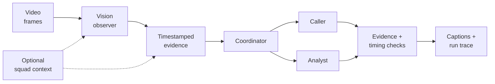
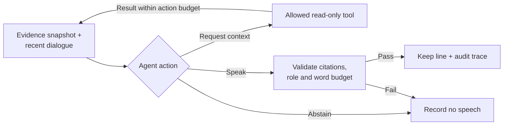

# AI Football Commentary

[**Live demo**](https://www.aarshroongta.com/projects/soccer-commentary) · [Architecture](#architecture) · [Quick start](#quick-start) ·
[Usage](#usage) · [Evaluation](#evaluation) · [Project structure](#project-structure)

A multimodal, multi-agent prototype that turns football footage into play-by-play
and analysis. A visual observer supplies timestamped evidence; independent caller
and analyst agents decide what to say; deterministic code controls their turns.

Built with **Python, LangGraph, Pydantic, asyncio, OpenCV and Next.js**.
The focus is engineering around existing models: orchestration, grounded tool use,
evaluation, failure analysis and inspectable execution.

## Demo

The web app presents three short clips with AI caller/analyst voices and commentary captions:

| Example | Duration | Output provenance |
| --- | --- | --- |
| England–France penalty | 20s | Unedited generated words on saved perception and cited squad context. |
| Arsenal–Norwich finish | 18s | Fresh perception; exact retained words, source cut and one caption retimed. |
| Argentina–France attack | 20s | Fresh perception; source cut and one unsupported shirt-number phrase removed. |

These are selected **recorded examples prepared before playback**. The raw
outputs, failed attempts and exact editorial changes are retained in
[the demo artifacts](examples/portfolio-demo/README.md). The separate replay
prototype simulates speech occupancy; these clips do not measure live spoken latency.

Media is git-ignored and is not included in a fresh clone. The app falls back to
saved commentary when a video is unavailable. See [media setup](docs/PORTFOLIO.md)
for expected files and optional remote video URLs. The live demo hosts the three
featured clips and requires no API key to watch.

## Key capabilities

- **Multimodal perception:** sample video frames with OpenCV and produce typed
  action observations with timestamps, uncertainty and supporting-frame references.
- **Multi-agent orchestration:** separate LangGraph caller and analyst roles,
  each with its own prompt, evidence permissions and bounded tool loop.
- **Structured outputs and grounding:** Pydantic contracts and application checks
  enforce evidence visibility, citation validity, role permissions and word budgets.
- **Async coordination:** the causal replay runtime handles deadlines,
  cancellation, goal priority and stale-result rejection with asyncio.
- **Evaluation and observability:** a fixed 15-clip development suite, scripted
  regression tests, saved decisions, rejected turns and per-run token costs.
- **Cost control:** explicit dollar/call caps, reservations for maximum output,
  and no automatic provider retries in the bounded development runner.

## Architecture

### Recorded commentary pipeline



The observer proposes what happened; the language agents choose the commentary.
The coordinator owns timing and admission checks. It is ordinary Python, not an
LLM supervisor. The frontend plays saved results without making model calls.

### Agent responsibilities

| Component | Responsibility | Boundary |
| --- | --- | --- |
| Researcher | Prepare optional cited, dated squad/team context before the match cutoff. | Research cannot prove an on-pitch action or identify a player by itself. |
| Observer | Propose timestamped actions, supporting frames and readable identity cues. The replay observer can request a bounded crop and roster context. | Unclear actions remain uncertain; identity must be linked to the observed action. |
| Caller | React to immediate play and confirmed goal observations. | Requires visual evidence; cannot use research or announce uncertain/replay actions as live play. |
| Analyst | Explain supported movement or add relevant context. | Complements the caller; may abstain when there is no useful supported point. |
| Coordinator | Schedule turns and enforce evidence/time/role constraints. | A structurally valid observation can still be visually wrong. |

### One speaking-agent turn



Each role receives a snapshot of available observations, recent dialogue and
remaining action/word budgets. It returns a typed `AgentAction`: `tool`, `speak`
or `abstain`. The application executes permitted tools and routes their results
back to the same role through LangGraph.

The read-only tools are `recent_events`, `player_context`, and analyst-only
`research`. This is an **application-managed structured action protocol**, rather
than provider-native function calling. Context retrieval is scoped to the supplied
evidence/research; a squad lookup does not establish who performed an action.

Every spoken line carries evidence references. For example, the saved penalty run
retained this `SpeechLine`:

```json
{
  "voice": "caller",
  "text": "Kane scores! Low to the left, and England have the goal",
  "evidence_ids": [
    "recorded-4"
  ],
  "research_ids": []
}
```

Checks reject unavailable evidence, wrong-role citations, exact repeats about the same evidence,
and oversized drafts. An optional reviewer can request bounded revisions; it is
**disabled in the selected examples** after an observed false rejection.

### Recorded preparation vs. causal replay

| Path | Evidence and scheduling | Output |
| --- | --- | --- |
| Recorded preparation | Vision sees the whole short clip. Speaking turns receive evidence according to source timestamps; code reserves reading time. | Precomputed commentary plan, captions and trace. |
| Causal replay prototype | Frames arrive over a replay clock. asyncio manages pending work, deadlines, cancellation and stale results. | Execution trace and text with simulated speech occupancy. |

These paths share role agents and contracts, but have different timing semantics.
See [the replay design](docs/REPLAY.md) for the asynchronous runtime.

## Quick start

### Requirements

- Python 3.12+ and [uv](https://docs.astral.sh/uv/).
- Node.js 22+ and npm; CI uses Node 22.
- FFmpeg with subtitle support and ffprobe for media rendering. The Python `demo`
  extra provides a compatible bundled FFmpeg binary.

### Run the web demo

From the repository root:

```bash
npm ci --prefix web
npm run dev --prefix web
```

Open **http://127.0.0.1:3000/demo**. No API key is needed to browse saved output.
The optional run inspector is at `/demo/engineering/runs`.

### Set up the Python tools

```bash
uv sync --extra demo --dev
```

For paid model generation only, copy `.env.example` to `.env` and set
`OPENAI_API_KEY`. Browsing, caption rendering and the scripted diagnostic do not
require model credentials. Existing models are used; no weights are trained or
fine-tuned.

## Usage

### Run a free diagnostic

```bash
uv run python scripts/replay_commentary.py --diagnostic --rate 10 \
  --out runs/replay/diagnostic.json
```

This uses fictional observations and a scripted backend to exercise coordination
and tool use. It checks control flow, not perception or natural commentary quality.

### Prepare a recorded clip

This example expects the matching Argentina–France footage at the local path shown.
Its tracked input files contain team/kit metadata and an empty research brief;
no target commentary or evaluation labels enter the agents.

```bash
uv run python scripts/prepare_agent_demo.py \
  --clip clips/demo-sources/argentina-france-dimaria.mp4 \
  --start 12 --duration 28 \
  --teams examples/portfolio-demo/release/argentina-teams.json \
  --research examples/portfolio-demo/release/argentina-research.json \
  --observer-model gpt-5.4-mini --speaker-model gpt-5.4-mini \
  --no-review --max-usd 0.20 --max-model-calls 24 \
  --out-dir runs/my-demo
```

The command is a **dry run by default**. Add `--spend` to enable generation after
configuring credentials. Choose a new output directory for each attempt; the
runner refuses to overwrite an existing one. The recorded path supports clips up
to 30 seconds.

A completed run saves `observations.json`, `plan.json`, `result.json` and captured
provider responses. They preserve the source hash, model choices, exact words,
role/tool decisions, rejected turns, usage and budget accounting.

### Render captions without voice synthesis

After generating a plan:

```bash
uv run python scripts/render_text_demo.py \
  --plan runs/my-demo/plan.json \
  --clip clips/demo-sources/argentina-france-dimaria.mp4 \
  --out runs/my-demo/captioned.mp4 --label ''
```

Rendering uses local FFmpeg, strips source audio and makes no model or TTS calls.
Caption intervals estimate reading time; they are not measured speech latency.
Plans, edits and render reports remain separate, so presentation changes can be
compared with the original model output.

## Evaluation

The fixed development selection is
[`examples/action-suite.json`](examples/action-suite.json): **15 clips, 112.5
seconds**, spanning routine play, dribbles, tackles, saves, goals and decisions.
Reference labels and target commentary stay outside runtime inputs.

The evaluation separates perception, identity, factual grounding, timing and
dialogue. Draft labels are not human-approved held-out ground truth.

### Findings and iterations

| Finding | Engineering response |
| --- | --- |
| Drafts could not fit after their supporting frames arrived. | Added explicit per-turn word budgets and more actionable timing feedback. |
| Uncertain/replay evidence was handled inconsistently between comparison paths. | Aligned role-permission checks; retained the original failed results. |
| A reviewer rejected even “Kane scores!” twice. | Disabled the optional reviewer in the selected penalty run, retaining deterministic checks. |
| A false visual goal reached both writers through shared evidence. | Traced the upstream failure and preserved it as a limitation; schema/citation checks do not independently verify pixels. |

The text pilot had **12 usable perception inputs; 5 of 24 attempted writer arms
passed structural checks**. Integration failures and a validation asymmetry
prevented a meaningful architecture-quality ranking. These are diagnostic counts,
not an accuracy score. See [the full trial](docs/TEXT_EVALUATION_TRIAL.md).

### A retained before/after example

The two penalty attempts use the same footage, saved evidence and research, with
unedited generated words:

| Observed measure | Reviewer enabled | Reviewer disabled |
| --- | --- | --- |
| Caller announces the goal | No | Yes |
| Model calls | 17 | 9 |
| Reported token cost | $0.01796 | $0.00871 |
| First call | 1s | 3s |

The later run restored the caller-to-analyst handoff, but started later. This is
one development pair with uncontrolled generation variation, not proof of a
suite-wide quality or cost improvement. The
[comparison record](examples/portfolio-demo/iteration.json) retains input hashes,
outputs and tradeoffs.

Four additional fresh-vision demo attempts cost **$0.27827** in reported tokens
under a **$0.80** combined cap. Both selected outputs and failures remain in
[the release record](examples/portfolio-demo/release/README.md).

## Development

```bash
uv run pytest -q
uv run ruff check .
uv run ruff format --check .
uv run mypy
npm run lint --prefix web
npm run build --prefix web
```

Regression tests use scripted backends and make no paid model calls.
[GitHub Actions](.github/workflows/ci.yml) runs Python tests/lint/type checks and
web lint/build checks. Stop an existing production web server before rebuilding
over its `.next` output.

## Project structure

```text
src/commentary/
  replay/
    agents.py          # LangGraph role loops and read-only tools
    contracts.py       # Pydantic actions, snapshots and speech contracts
    recorded.py        # Full-context vision and source-timed preparation
    runtime.py         # Async causal replay coordinator
    preparation.py     # Replay vision and pre-match research
    evaluation.py      # Replay evaluation checks
  llm/
    openai_backend.py  # Responses API / structured-output adapter
    budget.py          # Call limits and concurrency-safe reservations
scripts/               # Preparation, comparison, diagnostics and rendering CLIs
examples/              # Selected runs, evaluation inputs and retained failures
tests/                 # Offline regression tests
web/                   # Next.js showcase and optional saved-run inspector
docs/                  # Design notes, evaluations and reproduction guides
```

## Current limitations

- Vision can confidently misclassify events; downstream agreement is not
  independent verification. Player identity is especially sensitive to small or
  unreadable shirt details.
- The featured clips are selected development output with disclosed source cuts
  and light edits, not an untouched end-to-end benchmark.
- The replay prototype simulates speech occupancy. Production streaming quality
  and real-time spoken latency are not established by this demo.
- More agents add requests, delay and failure paths. A general quality advantage
  over a single writer has not been demonstrated.
