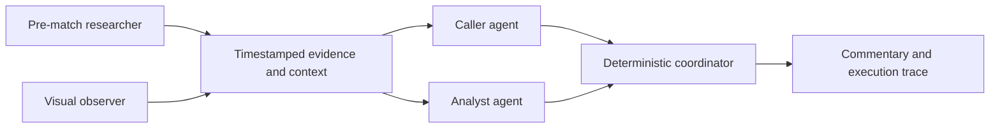

# Football commentary agents

A multi-agent football commentary prototype built with **Python, LangGraph,
asyncio, Pydantic, OpenCV and Next.js**. A visual observer and pre-match researcher
supply context to separate caller and analyst agents. Bounded tools, evidence
contracts and a deterministic coordinator keep their decisions inspectable.

[Portfolio case study](docs/PORTFOLIO_CASE_STUDY.md) ·
[Demo setup](docs/PORTFOLIO.md) ·
[Evaluation findings](docs/TEXT_EVALUATION_TRIAL.md)

## Watch the selected examples

```bash
npm ci --prefix web
npm run dev --prefix web
```

Open http://127.0.0.1:3000/demo. Browsing clips and traces makes no model calls.

| Example | What it shows |
| --- | --- |
| England vs France, 20s | Automatic caller/analyst dialogue using saved perception and cited squad context. Exact generated words, source-time turns and rejected drafts are inspectable. |
| Arsenal vs Norwich, 28s | An edited showcase of a team goal, with caller bursts and analyst responses. |
| Argentina vs France, 28s | An edited showcase of a counterattack and finish. |

These three videos are silent and captioned. The two edited showcases are labelled;
they are not untouched multi-agent output. The automatic example is prepared
before playback and is not a demonstration of live speech latency. Its before/after
switch shows a matched development iteration: an optional reviewer suppressed a
supported caller goal draft; disabling it restored the caller/analyst handoff.
Both outputs are unedited, with input hashes, costs and trade-offs retained.

Media is local and git-ignored. Without it, the transcripts and traces still work;
see [media setup](docs/PORTFOLIO.md). The separate
[existing public portfolio page](https://www.aarshroongta.com/projects/soccer-commentary)
shows an earlier version. Local changes do not deploy automatically.

## How the system works



The observer can inspect a bounded crop and request a researched squad before
proposing an action-linked identity. The caller and analyst have separate prompts,
permissions and LangGraph tool loops; they can request context, speak or abstain.
Tools use a structured application action protocol. Code validates proposed
identities and references rather than choosing a player from a shirt number.

The causal replay coordinator owns clocks, deadlines, cancellation, goal priority
and stale-result rejection. Speech occupancy is simulated. Recorded preparation
instead generates source-timed dialogue before playback using full-context vision.
A bounded reviewer is optional; the selected automatic demo leaves it disabled.
See [the replay design](docs/REPLAY.md) for these distinct paths.

## Evaluation and engineering decisions

The fixed development suite contains 15 short clips, 112.5 seconds total. It covers
routine play, dribbling, goals, saves and referee decisions. References and target
commentary stay outside runtime inputs. Labels are sparse drafts, not human-approved
or held-out ground truth.

A text pilot obtained 12 usable perception inputs; 5 of 24 writer attempts passed
structural checks. Execution failures and an asymmetric validation rule prevented
a meaningful architecture-quality comparison. Later targeted changes improved
word-budget feedback and turn scheduling. No general multi-agent quality advantage
is claimed.

The most useful failure was a false goal that reached both writers through shared
perception. Valid citations and self-reported visual cue tags did not establish
factual truth; a larger model also made the mistake. The
[focused investigation](docs/FALSE_GOAL_INVESTIGATION.md) distinguishes confirmed
failure propagation from uncertain visual causes.

The repository retains inputs, exact outputs, rejected attempts, model IDs, costs
and traces. Regression tests use scripted backends. Paid experiments have hard
dollar/call limits and no automatic provider retries. Existing models are used;
there is no weight training, fine-tuning or RL.

## Run the Python tools

Requires Python 3.12+, uv and FFmpeg:

```bash
uv sync --extra demo --dev
uv run pytest -q
uv run mypy
uv run ruff check src tests
```

A free synthetic diagnostic exercises tools and coordination without credentials:

```bash
uv run python scripts/replay_commentary.py --diagnostic --rate 10 \
  --out runs/replay/diagnostic.json
```

Paid preparation commands require explicit `--spend` and credentials in a local
`.env`. See [recorded preparation](docs/DEMO.md),
[text evaluation](docs/TEXT_EVALUATION.md), and
[the selected automatic run](examples/portfolio-demo/README.md).

The `/live` browser experiment remains available locally. It produces delayed
text, can misidentify events, and does not establish production-ready streaming
commentary. Future work is scoped in the case study; the portfolio release does
not require solving every recognition failure.
