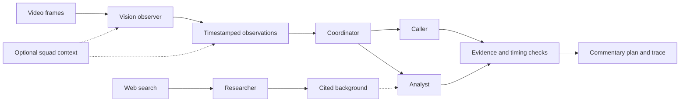

# AI Football Commentary

[**Commentary clips**](https://www.aarshroongta.com/projects/soccer-commentary) ·
[Architecture](#architecture) · [Quick start](#quick-start) · [Evaluation](#evaluation)

AI commentary for short football clips, with a play-by-play caller and an analyst.
A vision agent watches the footage, a researcher finds relevant background, and the
speaking agents decide what to say. Python code handles timing and checks what
each agent is allowed to use.

Built with Python, LangGraph, Pydantic, asyncio, OpenCV and Next.js. Generation
uses existing models; there is no training or fine-tuning.

## Demo

The [commentary memory replay](https://www.aarshroongta.com/demo/noeri) shows
lessons accumulating from earlier calls, then being referenced by later calls
over the same penalty footage. The [saved call history](examples/lesson-memory/session/README.md)
includes exact model inputs and outputs. An earlier three-clip comparison,
including a regression, remains in [the experiment record](examples/lesson-memory/README.md).
The subsequent [later-in-the-match transfer test](examples/lesson-memory/transfer/README.md)
did not establish a recognition improvement from memory. The existing public
memory view should not be interpreted as evidence of successful transfer.

The [commentary page](https://www.aarshroongta.com/projects/soccer-commentary) has
three clips with two voices and captions:

| Clip | Length |
| --- | ---: |
| England–France penalty | 19s |
| Arsenal–Norwich finish | 18s |
| Argentina–France attack | 20s |

These scripts were edited against the footage after the initial narration proved
too sparse. They are prepared demos, not unedited agent output or measurements
of live speech latency. The penalty clip keeps the original generated goal call.
[Original runs and failures](examples/portfolio-demo/README.md) and
[edited scripts](examples/portfolio-demo/edited-showcase/README.md) are kept separately.

## Architecture

### Watching and calling the play



| Component | Job |
| --- | --- |
| Observer | Report actions, uncertainty and supporting frames. It can request a crop or roster context to help identify a player. |
| Researcher | Find cited player and team background for the analyst. |
| Caller | React to immediate play using visual evidence. |
| Analyst | Explain supported movement or add relevant background. |
| Coordinator | Schedule turns, prioritize goals, reject stale results and check role permissions. |

The coordinator is ordinary Python. LangGraph runs each speaking agent's tool
loop; asyncio handles pending work, deadlines and cancellation.

### Research

The researcher uses Keenable for web retrieval. The
[`search adapter`](src/commentary/search_providers.py) returns ranked excerpts,
source URLs and request timings as a `SearchRun`; Exa uses the same format for
comparison. Saved briefs and model-native web search are also supported.

[`prepare_research`](src/commentary/replay/preparation.py) checks supporting quotes
against returned excerpts and builds a dated `ResearchBrief` for the analyst's
`research` tool. Background facts can add context to a goal, but visual evidence
is still needed to establish the action.

The [event-triggered path](src/commentary/live_research.py) starts with the first
successful search response, selects an exact source passage, then passes it and
the reviewed event to the writer. Selection and writing use `gpt-5.4-mini`, followed
by ElevenLabs `eleven_flash_v2_5` for speech. Search runs concurrently so writing
can start without waiting for both providers. See the
[search workflow notes](examples/keenable-outreach/README.md) for settings and timing records.

The [Graphon review archive demo](docs/GRAPHON_DEMO.md) separately searches eight
existing failure and experiment reports. It retrieves versioned passages for
offline debugging; those retrospective reports do not enter runtime commentary.

### How an agent takes a turn

Each speaking agent gets the available observations, recent dialogue and remaining
word and action budgets. It returns a Pydantic `AgentAction`: `tool`, `speak` or
`abstain`. Code executes allowed tool requests and returns the result to that agent.
The tools are `recent_events`, `player_context` and analyst-only `research`.
This protocol is managed by the application rather than provider-native tool calling.

Spoken lines reference their evidence. For example:

```json
{
  "voice": "caller",
  "text": "Kane scores! Low to the left, and England have the goal",
  "evidence_ids": ["recorded-4"],
  "research_ids": []
}
```

Checks reject unavailable evidence, citations the role cannot use, repeated coverage
of the same evidence and lines over the word budget. The optional model reviewer
is disabled in the selected examples after it rejected valid goal calls.

### Recorded runs and causal replay

The recorded path lets vision see the whole clip, then gives speaking agents
evidence according to source timestamps. It produces a saved commentary plan.

The causal replay prototype feeds frames over a replay clock and handles work as
it arrives. It records text and simulates how long speech occupies a turn. Both
paths share the role agents and contracts. See [the replay design](docs/REPLAY.md).

## Quick start

You need Node.js 22+ and npm for the web app. Python tools need Python 3.12+ and
[uv](https://docs.astral.sh/uv/). Rendering also needs FFmpeg with subtitle support
and ffprobe; the Python `demo` extra includes a compatible FFmpeg binary.

From the repo root:

```bash
npm ci --prefix web
npm run dev --prefix web
```

| Local route | What it shows |
| --- | --- |
| `/demo` | Saved commentary clips |
| `/demo/replay?mode=replay` | Saved search and commentary workflow |
| `/demo/replay` | Live search comparison; playback triggers paid calls when configured |
| `/demo/replay?run=penalty` | Original penalty run with frames, tool calls and agent decisions |
| `/demo/engineering/runs` | Saved-run inspector |

Start at **http://127.0.0.1:3000/demo**. Saved output needs no API keys.
Media is gitignored, so a fresh clone needs the assets restored to play the videos.
The commentary page falls back to saved text when footage is missing.
See [media setup](docs/PORTFOLIO.md) and [penalty recording instructions](docs/RECORDABLE_REPLAY.md).

Install the Python tools with:

```bash
uv sync --extra demo --dev
```

For generation, copy `.env.example` to `.env`. Set `OPENAI_API_KEY` for research,
vision and writing. The live research path also needs `KEENABLE_API_KEY`,
`EXA_API_KEY`, `ELEVENLABS_API_KEY` and the voice IDs documented in `.env.example`.
Keys stay on the server. Live mode allows one active run and three runs per server
session. Each run allows two model calls with a combined $0.05 cap and up to
240 characters of voice input.
Search and voice charges are separate from the model cap.

## Usage

With the footage restored and `OPENAI_API_KEY` set, generate a commentary plan:

```bash
uv run python scripts/prepare_agent_demo.py \
  --clip clips/demo-sources/argentina-france-dimaria.mp4 \
  --start 12 --duration 28 \
  --teams examples/portfolio-demo/release/argentina-teams.json \
  --research examples/portfolio-demo/release/argentina-research.json \
  --no-review --max-usd 0.20 --max-model-calls 24 \
  --out-dir runs/my-demo --spend
```

This runs vision and dialogue generation with `gpt-5.4-mini`, capped at $0.20 and
24 model calls. Omit `--spend` to validate the inputs without calling a model.
Use a new output directory for each run. For another match, change the footage,
clip window and team/research JSON files. Clips can be up to 30 seconds long.

The output directory contains:

| File | What to inspect |
| --- | --- |
| `observations.json` | What the observer saw, supporting-frame timestamps and identity lookups |
| `plan.json` | Commentary lines, speakers, timestamps and evidence references |
| `result.json` | Agent decisions, rejected turns, errors and budget usage |
| `response-*.json` | Captured provider responses |

To try dialogue changes on the same footage, add
`--reuse-vision runs/my-demo/observations.json` and choose a new output directory.
This reuses the visual observations while rerunning identity resolution and dialogue.

Render the plan as a captioned video:

```bash
uv run python scripts/render_text_demo.py \
  --plan runs/my-demo/plan.json \
  --clip clips/demo-sources/argentina-france-dimaria.mp4 \
  --out runs/my-demo/captioned.mp4 --label ''
```

Rendering is local, removes source audio and makes no paid calls. Caption timing
estimates reading time. The generated plan stays unchanged by rendering or later edits.

## Evaluation

The evaluation harness follows a run from observations through tool calls to spoken
lines. It saves the failures alongside the output, so changes to prompts, models or
scheduling can be checked against the same inputs.

The development set is [15 clips totaling 112.5 seconds](examples/action-suite.json),
covering routine play, dribbles, tackles, saves, goals and decisions. Reference labels
and target commentary stay outside agent inputs. The labels still need human review.

### What the harness checks

[`evaluate_replay.py`](scripts/evaluate_replay.py) scores a saved replay against a
separate reference file. Its [scorecard](src/commentary/replay/evaluation.py) reports:

| Area | Checks and measurements |
| --- | --- |
| Recognition | One-to-one event/time matches, missed events, unmatched detections, action and ball-path confusions |
| Identity and grounding | Resolved player names, unknown or future evidence citations, research citation IDs |
| Timing and dialogue | Event-to-scheduled-speech delay (p50/p95), cited-event coverage, overlaps and interruptions |
| Execution | Tool calls, timeouts, stale results, rejected turns, provider errors and budget stops |

Timing uses the run's speech clock, which is simulated in the causal replay prototype.
Event matches and valid citations are mechanical checks. Factual meaning, useful
analysis and natural dialogue require separate source review using the
[text review rubric](docs/TEXT_EVALUATION.md).

Run a complete synthetic replay and score it without footage, keys or paid calls:

```bash
uv run python scripts/replay_commentary.py --diagnostic --rate 10 \
  --out runs/eval/smoke.json
uv run python scripts/evaluate_replay.py \
  --run runs/eval/smoke.json \
  --reference examples/replay-evaluation/diagnostic.json \
  --out runs/eval/scorecard.json
```

This exercises the coordinator, agent tool loops and scoring with scripted agents.
[Regression tests](tests/test_replay_runtime.py) also cover delayed responses,
goal interruptions, stale work, cancellation and evidence arriving out of order.

### Comparing writers

[`compare_text.py`](scripts/compare_text.py) compares a joint writer with separate
caller/analyst agents using identical saved observations, identities and research.
It checks source hashes and clip windows, holds the model and resource limits fixed
across both paths, and exports anonymized pairs for review. Each attempt retains
prompt/input hashes, raw responses, rejected drafts, usage and cost. Failed and
missing runs stay in the report.

This isolates writing and coordination from changes in perception. It is an offline
text comparison; it does not measure live speech delivery.

### What it caught

| Finding | Change or consequence |
| --- | --- |
| Drafts could not fit after their supporting frames arrived. | Added per-evidence word allowances and explicit timing feedback. |
| The writer paths applied different checks to uncertain and replay evidence. | Aligned the checks; kept the original results out of architecture rankings. |
| The model reviewer rejected “Kane scores!” twice. | Disabled it in the selected penalty run while keeping code-based checks. |
| Both writers announced a goal from the same false observation. | Source review traced the mistake to perception; valid citations had not caught it. |

The first text pilot had 12 usable perception inputs and 5 of 24 writer attempts
passed structural checks. Those counts describe execution, not commentary accuracy.
In one penalty comparison, disabling the reviewer reduced model calls from 17 to 9
and token cost from $0.01796 to $0.00871, but moved the first call from 1s to 3s.
These results guide debugging; they do not establish an overall quality improvement.

See the [trial report](docs/TEXT_EVALUATION_TRIAL.md),
[penalty comparison](examples/portfolio-demo/iteration.json) and
[release runs and costs](examples/portfolio-demo/release/README.md).

## Current limitations

- Vision can misread actions and player identities, especially with small or unclear
  shirt details. Agreement between writers does not verify a shared observation.
- The replay prototype simulates speech timing. Production streaming and live
  spoken latency still need testing.
- Multiple agents add calls and delay. The evaluations so far do not establish
  better commentary quality than a single writer.

## Development

```bash
uv run pytest -q
uv run ruff check .
uv run ruff format --check .
uv run mypy
npm run lint --prefix web
npm run build --prefix web
```

Regression tests use scripted backends and make no paid calls.
[CI](.github/workflows/ci.yml) runs Python tests, lint and type checks, plus web lint
and build checks. Stop an existing production web server before rebuilding its
`.next` output.

## Project structure

```text
src/commentary/
  search_providers.py  # Keenable / Exa adapters and source records
  live_research.py     # Concurrent search, passage selection, writing and voice
  replay/
    agents.py          # LangGraph role loops and read-only tools
    contracts.py       # Pydantic actions, snapshots and speech contracts
    recorded.py        # Recorded vision and commentary preparation
    runtime.py         # Async causal replay coordinator
    preparation.py     # Vision, identity and research preparation
    evaluation.py      # Replay checks
  llm/
    openai_backend.py  # Responses API and structured outputs
    budget.py          # Call limits and cost reservations
scripts/               # Preparation, comparison, diagnostics and rendering
examples/              # Saved runs, evaluation inputs and failures
tests/                 # Offline regression tests
web/                   # Next.js demo and run inspectors
docs/                  # Design notes and reproduction guides
```
