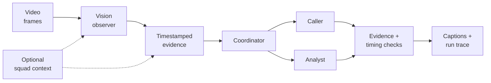
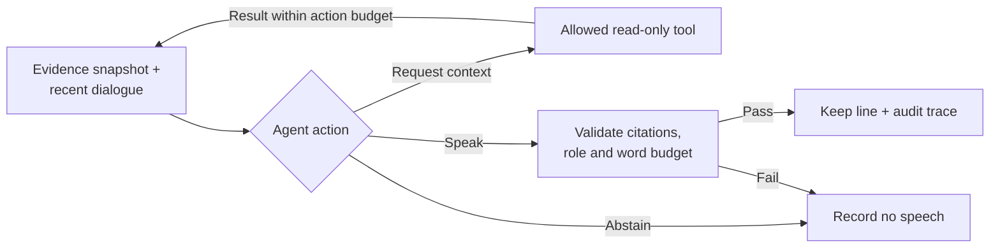

# How I built it: Football commentary agents

A Python/LangGraph prototype that turns football footage into evidence-grounded
caller/analyst dialogue using existing vision and language models.

## System architecture

This is recorded preparation, not a measured live speech system. England reuses
saved perception and cited squad context; Arsenal and Argentina use fresh vision
and disclosed light edits.

## Engineering skills demonstrated

| Skill | Implementation |
| --- | --- |
| Multimodal inference | OpenCV frame sampling; timestamped structured observations from a vision model. |
| Agent orchestration | Independent LangGraph caller/analyst roles, bounded action loops, abstention. |
| Structured outputs and grounding | Pydantic contracts, evidence cutoffs, role permissions and word budgets. |
| Tool-augmented generation | Application-managed read-only recent_events, player_context and analyst research tools. |
| Async systems | Separate replay prototype: asyncio deadlines, cancellation, goal priority and stale-result rejection. |
| LLM evaluation | Fixed 15-clip development suite; independent checks of perception, identity, grounding, timing and dialogue. |
| Observability and cost control | Saved outputs, tool decisions, rejected turns, token costs, call limits and budget reservations. |

## Inside one agent turn

Tool use is a typed application action protocol. The optional model reviewer is
disabled in the selected runs; deterministic checks remain enabled. Regression
tests use scripted backends and make no paid model calls.

## Evaluation-driven decisions

- Short clips exposed drafts that could not fit after their evidence arrived.
  Per-turn word budgets and explicit rejection feedback make timing enforceable.
- In one saved penalty pair, the reviewer rejected “Kane scores!” twice. Disabling
  it restored the caller-to-analyst handoff; calls fell from 17 to 9, while the
  first call moved from 1s to 3s. One pair does not establish general improvement.
- A false goal propagated from shared vision to both writers. Schema validation
  and citations check structure, not factual truth. Failed traces remain available.

The pilot had 12 usable perception inputs and 5/24 writer attempts passed structural
checks. The 15 clips have draft development labels, not held-out ground truth.
No general multi-agent quality advantage or live speech latency is claimed.

## Resume wording

Built a Python/LangGraph football commentary prototype with multimodal perception,
tool-using caller and analyst agents, timestamped evidence checks, and a 15-clip
evaluation workflow with reproducible failure traces.

## Where to look

- scripts/prepare_agent_demo.py: budgeted recorded preparation.
- src/commentary/replay/recorded.py: vision preparation and source-time turns.
- src/commentary/replay/agents.py: LangGraph role actions, tools and validation.
- src/commentary/replay/runtime.py: the separate causal replay coordinator.
- src/commentary/replay/contracts.py: Pydantic contracts and evidence visibility.
- src/commentary/llm/budget.py: call limits and concurrency-safe reservations.

Local pages: /demo for the recruiter showcase; /demo/engineering for this case
study; /demo/engineering/runs for the retained interactive run inspector.
